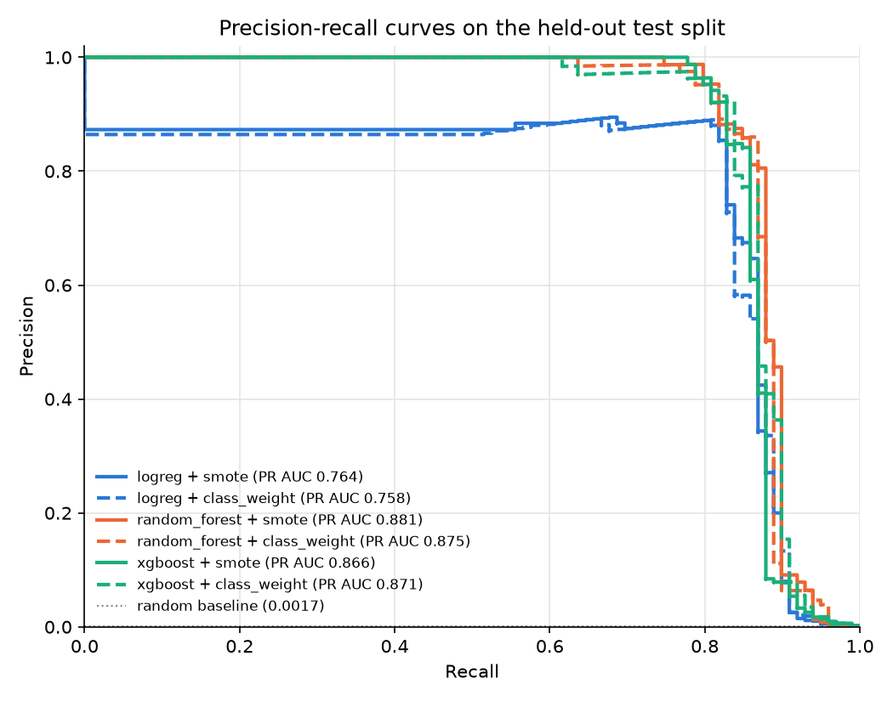

# Credit Card Fraud Detection

The saved model is **XGBoost with class weights**, chosen by its PR AUC on the validation split. On the held-out test split it reaches **PR AUC 0.8707**. At the validation-tuned threshold it has **precision 0.9524 and recall 0.8081**: it caught 80 of 99 frauds and raised 4 false alarms among 56,863 normal transactions.
Only **0.17%** of transactions are fraud, so accuracy and ROC AUC look excellent even for weak models. PR AUC is the main metric because it measures how well the model ranks the rare fraud cases.



## Pipeline

[`train.py`](train.py) is the single source of every number in this README. It writes them to [`reports/metrics.json`](reports/metrics.json).

1. **Data**: the Kaggle/ULB `creditcard.csv` (284,807 transactions, 492 frauds), read from the path in the `FRAUD_CSV` environment variable.
2. **Split**: stratified random 60/20/20 train/validation/test split (seed 42). Each split has 98–99 frauds.
3. **Pipeline**: one `imblearn` Pipeline of `StandardScaler`, then optional `SMOTE`, then the model. Because the scaler and SMOTE sit inside the pipeline, they are fit on the training split only, and SMOTE never touches validation or test data.
4. **Models**: Logistic Regression, Random Forest and XGBoost, all with fixed settings (no hyperparameter tuning). Each runs twice: once with **SMOTE**, and once with **class weights only** (`class_weight="balanced"` / `"balanced_subsample"`, or XGBoost `scale_pos_weight`).
5. **Threshold**: chosen on the validation split as the threshold that gives the highest F1, then applied unchanged to the test split.
6. **Selection**: the variant with the highest validation PR AUC is saved, with its scaler and threshold, to `models/fraud_pipeline.joblib`. The test split is reported but never used for choosing.

PR AUC is computed as average precision (`sklearn.metrics.average_precision_score`). A random classifier would score about 0.0017.

## Results

Test split: 56,962 transactions, 99 frauds. Precision, recall and the TP / FP / FN counts use each model's validation-tuned threshold. The saved model is in bold.

| Model | Balancing | Val PR AUC | Test PR AUC | Test ROC AUC | Precision | Recall | TP / FP / FN |
|---|---|---|---|---|---|---|---|
| Logistic Regression | SMOTE | 0.6857 | 0.7636 | 0.9657 | 0.8876 | 0.7980 | 79 / 10 / 20 |
| Logistic Regression | Class weights | 0.6857 | 0.7575 | 0.9662 | 0.8864 | 0.7879 | 78 / 10 / 21 |
| Random Forest | SMOTE | 0.8185 | 0.8811 | 0.9703 | 0.8804 | 0.8182 | 81 / 11 / 18 |
| Random Forest | Class weights | 0.7917 | 0.8750 | 0.9771 | 0.9310 | 0.8182 | 81 / 6 / 18 |
| XGBoost | SMOTE | 0.8006 | 0.8659 | 0.9796 | 0.9205 | 0.8182 | 81 / 7 / 18 |
| **XGBoost** | **Class weights** | 0.8271 | 0.8707 | 0.9709 | 0.9524 | 0.8081 | 80 / 4 / 19 |

**How to read this:**
- **Tree models clearly beat Logistic Regression.** They score 0.10–0.14 higher in PR AUC on both the validation and test splits.
- **SMOTE vs. class weights makes no reliable difference.** Neither one wins consistently across models or splits.
- **Small gaps are noise.** Each split has only about 98 frauds, so one fraud more or less moves recall by about 0.01. Differences of 0.01–0.03 between the tree models, and between validation and test, are within noise. Random Forest + SMOTE has the highest test PR AUC, but the model was chosen on validation, so that result is not used.
- **ROC AUC hardly separates the models** (0.966–0.980). This is why it is shown only next to PR AUC.

## Transaction replay demo

[`streamlit_app.py`](streamlit_app.py) replays [`data/demo_transactions.csv`](data/demo_transactions.csv) one transaction at a time and scores each one with the saved pipeline and its tuned threshold. It also keeps a running count of true and false positives and negatives.

The demo file holds **200 rows from the test split, enriched to 15% fraud** (30 frauds, 170 normal transactions), so there are frauds to see. Real data has 0.17% fraud, so the demo's hit rate **says nothing about real-world precision**; use the results table above for that. The demo replays historical data: it is not a live stream and is not deployed anywhere.

## Setup

Download `creditcard.csv` from [Kaggle](https://www.kaggle.com/datasets/mlg-ulb/creditcardfraud). The dataset is not committed to this repo.

```bash
git clone https://github.com/Yigituysgl/credit-card-fraud-detection.git
cd credit-card-fraud-detection
python -m venv .venv
source .venv/bin/activate        # Windows: .venv\Scripts\activate
pip install -r requirements.txt
```

**Run `train.py` first.** `models/` is not committed, so the app needs the pipeline that `train.py` saves. Training takes about 1.5 minutes on a laptop. It writes `reports/metrics.json`, `docs/pr_curve.png`, `data/demo_transactions.csv` and `models/fraud_pipeline.joblib`.

```bash
export FRAUD_CSV=/path/to/creditcard.csv   # PowerShell: $env:FRAUD_CSV="C:\path\to\creditcard.csv"
python train.py
streamlit run streamlit_app.py
pytest
```

Tested with Python 3.11 and the pinned versions in `requirements.txt`.

## Repository layout

| Path | Contents |
|---|---|
| `train.py` | Split, pipelines, evaluation, model selection, demo sample |
| `streamlit_app.py` | Transaction replay demo |
| `reports/metrics.json` | All reported metrics, split sizes and library versions |
| `docs/pr_curve.png` | Precision-recall curves on the test split |
| `data/demo_transactions.csv` | 200-row demo sample from the test split |
| `tests/` | Pipeline fit and threshold-tuning tests |
| `Real-Time_Fraud_Det.ipynb` | Original exploratory notebook. It fits the scaler on the full dataset before splitting and compares models on the test set, so `train.py` replaces it and its numbers are not current. |

## Limitations

- **Anonymized features.** V1–V28 are PCA components released in anonymized form, so the features cannot be interpreted or engineered, and the results do not transfer to raw transaction data.
- **Two days of data.** All transactions come from two days in September 2013. Seasonality and drift are not represented.
- **Random split, not time-based.** Training and test transactions come from the same period. A time-ordered split, which is closer to deployment, would probably give lower scores.
- **Single run.** Each score comes from one split and one seed, with no cross-validation or confidence intervals. With about 98 frauds per split, the uncertainty is large (see the table notes).
- **Logistic Regression scores saturate.** Many cases score about 0.9999999, so the top of its ranking is tied. This is why both LR variants share a validation PR AUC of 0.6857 and their tuned thresholds are about 0.99999999. A score before the sigmoid (`decision_function`) would rank these cases better.
- **No live stream.** The app replays a fixed CSV. There is no streaming ingestion, latency measurement or monitoring.

## Dataset

[Credit Card Fraud Detection](https://www.kaggle.com/datasets/mlg-ulb/creditcardfraud) on Kaggle, published by the Machine Learning Group of the Université Libre de Bruxelles (ULB) with Worldline. It is licensed under the Open Database License (ODbL) for the database and the Database Contents License (DbCL) for its contents. Source paper: A. Dal Pozzolo, O. Caelen, R. A. Johnson and G. Bontempi, *Calibrating Probability with Undersampling for Unbalanced Classification*, IEEE SSCI 2015.

## License

Code: [MIT](LICENSE). The dataset keeps its own license (see above).

## Author

Yigit Uysaloglu · [LinkedIn](https://www.linkedin.com/in/yigit-uysaloglu/) · [GitHub](https://github.com/Yigituysgl)
